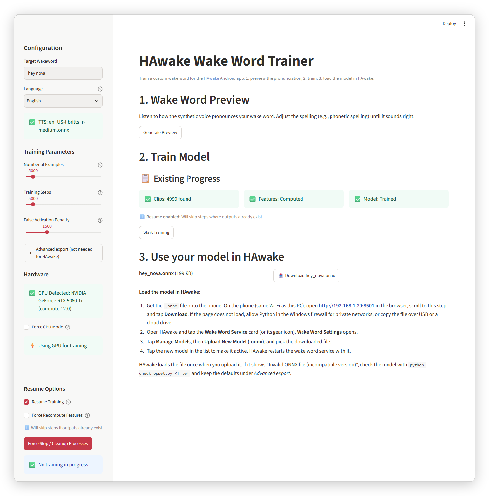
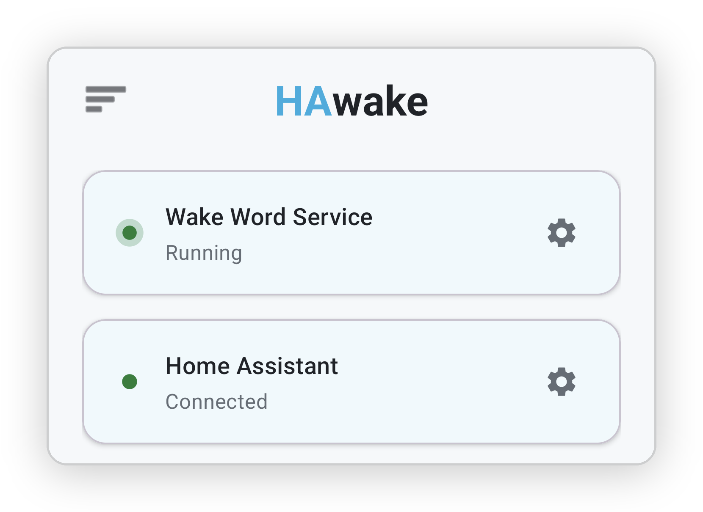

# HAwake WakeWord Training

Custom OpenWakeWord training pipeline for generating wake word models compatible with [HAwake Android](https://play.google.com/store/apps/details?id=com.baer.hawake).

## Quick start for HAwake users

Three steps: install the trainer on a PC, train your wake word in the browser, load the `.onnx` file in the HAwake app.

### 1. Install

You need Python 3.11, Git and about 25 GB of free disk space. An NVIDIA GPU makes training faster but is optional.

Windows (PowerShell):
```powershell
git clone https://github.com/IT-BAER/hawake-wakeword.git; cd hawake-wakeword; .\install.ps1
```

Windows (CMD):
```cmd
git clone https://github.com/IT-BAER/hawake-wakeword.git && cd hawake-wakeword && install.bat
```

Linux/macOS:
```bash
git clone https://github.com/IT-BAER/hawake-wakeword.git && cd hawake-wakeword && chmod +x install.sh && ./install.sh
```

The installer creates a virtual environment, picks the right PyTorch build for your GPU (or CPU), installs the dependencies, downloads the training data (17 GB of negative training features, about 1.5 GB of AudioSet background audio, room impulse responses) and opens the WebUI at http://localhost:8501. With an NVIDIA GPU, PyTorch alone is a 2 GB download. A finished installation uses about 22 GB.

If the installer ends with a WARNING about background audio or training features, a download failed or was skipped. Run `python download_data.py` again before you train. Without the 17 GB training features (`openwakeword_features_ACAV100M_2000_hrs_16bit.npy`) the model reacts to normal speech: in a test with the same clips it made about 9700 false activations per hour on the validation set, against about 9 with the file. To skip this download on purpose, set `HAWAKE_SKIP_LARGE_FEATURES=1`; the download is also skipped when less than 19 GB is free.

Later, start the WebUI again with `.\run_webui.ps1` (Windows) or `./run_webui.sh` (Linux/macOS).

### 2. Train your wake word

1. Enter your wake word in the sidebar, for example `hey nova`.
2. Click **Generate Preview** and listen. If the voice says it wrong, change the spelling (for example `hey noh va`) until it sounds right.
3. Click **Start Training**. Keep the browser tab open until the success message appears.



*The WebUI after a training run: settings in the sidebar, existing clips, features and model under step 2, and the download with the HAwake steps under step 3.*

With the defaults (5000 examples, 5000 steps) a training run took about 2 hours 15 minutes on a PC with a 6-core Ryzen 5 7500F and an RTX 5060 Ti. About 2 hours of that is the generation of the synthetic voice clips, which runs on the CPU even with a GPU. Computing the features and training the model took about 13 minutes on the GPU. A second run with other training settings reuses the clips (**Resume Training**) and takes minutes. See [Training settings](QUICKSTART.md#training-settings) for what the settings change.

### 3. Load the model in HAwake

Step 3 at the bottom of the WebUI lists every trained model with a download button and these instructions.

1. Get the `.onnx` file onto the phone. The easiest way: on the phone (same Wi-Fi as the PC), open the **Network URL** that the installer prints (for example `http://192.168.1.20:8501`), scroll to step 3 and tap **Download**. If the page does not load, allow Python in the Windows firewall for private networks, or copy the file over USB or a cloud drive. The file is also in the trainer folder: `<wake_word>/<wake_word>.onnx`.
2. Open HAwake and tap the **Wake Word Service** card (or its gear icon). **Wake Word Settings** opens.
3. Tap **Manage Models**, then **Upload New Model (.onnx)**, and pick the file.
4. Tap the new model in the list to make it active. HAwake restarts the wake word service with it.



*HAwake home screen: tap the Wake Word Service card or its gear icon to reach Manage Models.*


## Uninstall

### Windows (PowerShell)
```powershell
.\uninstall.ps1
```

### Windows (CMD)
```cmd
uninstall.bat
```

### Linux/macOS
```bash
./uninstall.sh
```

### Options
| Flag | Description |
|------|-------------|
| `--full` | Also remove downloaded TTS models (~200MB) |
| `--keep-venv` | Keep the virtual environment |
| `-y` | Skip confirmation prompts |

Example full cleanup:
```bash
./uninstall.sh --full -y
```

## Features

- **Streamlit WebUI** - Easy-to-use interface for training custom wake words
- **ONNX Opset 11** - Default opset for Android 8+ compatibility (selectable in WebUI)
- **Piper TTS** - High-quality synthetic voice generation
- **Auto-Patching** - Automatic IR version and attribute fixes for ONNX Runtime 1.14.0

## Requirements

- Python 3.11 (the installers check for it; newer Python versions lack wheels for piper-phonemize and other pinned packages)
- CUDA (optional, for GPU acceleration)
- About 25 GB free disk space (17 GB training features, about 5 GB for the environment, audio data and one trained wake word)

## Manual Setup

If you prefer manual installation:

### 1. Clone and Setup

```bash
git clone https://github.com/IT-BAER/hawake-wakeword.git
cd hawake-wakeword
python -m venv .venv
.venv\Scripts\activate  # Windows
pip install -r requirements.txt
python patch_torch_audiomentations.py   # torchaudio 2.1+ compatibility
python patch_dp.py                      # PyTorch 2.6+ compatibility
```

### 2. Download Training Data

```bash
python download_data.py     # Training features (17 GB), AudioSet background audio, validation set
python download_rirs.py     # Room impulse responses
```

### 3. Start WebUI

```bash
# Windows
.\run_webui.ps1

# Or directly
streamlit run app.py
```

### 4. Train a Wake Word

Continue with [2. Train your wake word](#2-train-your-wake-word).

## Configuration

| Parameter | Default | Description |
|-----------|---------|-------------|
| Target Opset | 11 | ONNX opset version (11 required for HAwake) |
| Number of Examples | 5000 | Synthetic training samples |
| Training Steps | 5000 | Model training iterations |
| False Activation Penalty | 1500 | Reduces false positives |

## CLI Training

For advanced users:

```bash
python train_local.py
```

It uses the same defaults as the WebUI and the GPU when one is available (set `CUDA_VISIBLE_DEVICES=-1` to force CPU). Edit the file to configure:
- `target_word` - Your wake word
- `number_of_examples` - Training sample count
- `number_of_training_steps` - Training iterations

## Integration with HAwake Android

See [3. Load the model in HAwake](#3-load-the-model-in-hawake). Developers who build HAwake themselves can also ship a model as an app asset in `hawake-android/app/src/main/assets/`.

### Optional: TFLite export

HAwake Android uses only the `.onnx` model. For a `.tflite` copy, install the extra packages (~1 GB with TensorFlow) and tick **Also export TFLite** in the WebUI, or set `export_tflite = True` in `train_local.py`:

```bash
pip install -r requirements-tflite.txt
```

## ONNX Compatibility

Models are exported with:
- **Selected Opset** (default 11) - Best Android 8+ compatibility
- **IR Version 7** - Required for ONNX Runtime 1.14.0
- **No `allowzero`** - Attribute removed from Reshape nodes

Verify with:
```bash
python check_opset.py my_model.onnx
```

## Project Structure

```
├── app.py                 # Streamlit WebUI
├── train_local.py         # CLI training script
├── check_opset.py         # ONNX version checker
├── convert_models.py      # Opset conversion utility
├── merge_models.py        # Merge embedding + classifier
├── openwakeword/          # OpenWakeWord library (modified)
│   └── openwakeword/
│       ├── train.py       # Training logic
│       └── resources/
│           └── models/    # Base feature extraction models
└── piper-sample-generator/ # TTS for synthetic audio
```

## Troubleshooting

### GPU Issues

| Issue | Solution |
|-------|----------|
| GPU detected but "no kernel image" | The installers pick the CUDA 13.0 PyTorch build for RTX 50 series (needs NVIDIA driver 580+). Update the driver, re-run the installer, or use "Force CPU Mode" in the WebUI |
| Training fails on GPU | Enable "Force CPU Mode" in WebUI sidebar |
| CUDA not available | Install NVIDIA drivers or use CPU mode |
| Wrong GPU detected | Set `CUDA_VISIBLE_DEVICES=0` environment variable |

The WebUI has a **"Force CPU Mode"** checkbox under Hardware settings that lets you disable GPU even if one is detected. This is useful for:
- Very new GPUs that don't have PyTorch kernels yet
- GPUs with insufficient memory
- Troubleshooting CUDA issues

### Other Issues

| Issue | Solution |
|-------|----------|
| Model crashes on Android | Run `check_opset.py` - must be Opset 11 |
| TTS sounds wrong | Adjust spelling phonetically |
| HAwake misses the wake word | Train again with more Training Steps, for example 20000; **Resume Training** reuses the clips. See [Training settings](QUICKSTART.md#training-settings) |
| Model reacts to normal speech | Check that `openwakeword_features_ACAV100M_2000_hrs_16bit.npy` exists, else run `python download_data.py`; raise the False Activation Penalty |

## Credits

- [OpenWakeWord](https://github.com/dscripka/openWakeWord) - Original project
- [Piper](https://github.com/rhasspy/piper) - TTS engine
- [ONNX Runtime](https://onnxruntime.ai/) - Model inference

## License

Apache 2.0 - See [LICENSE](LICENSE) for details.
